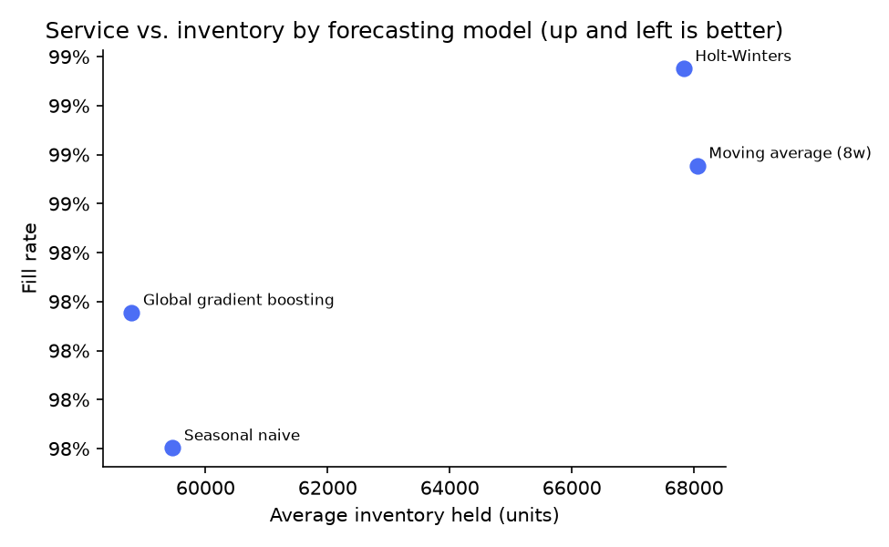
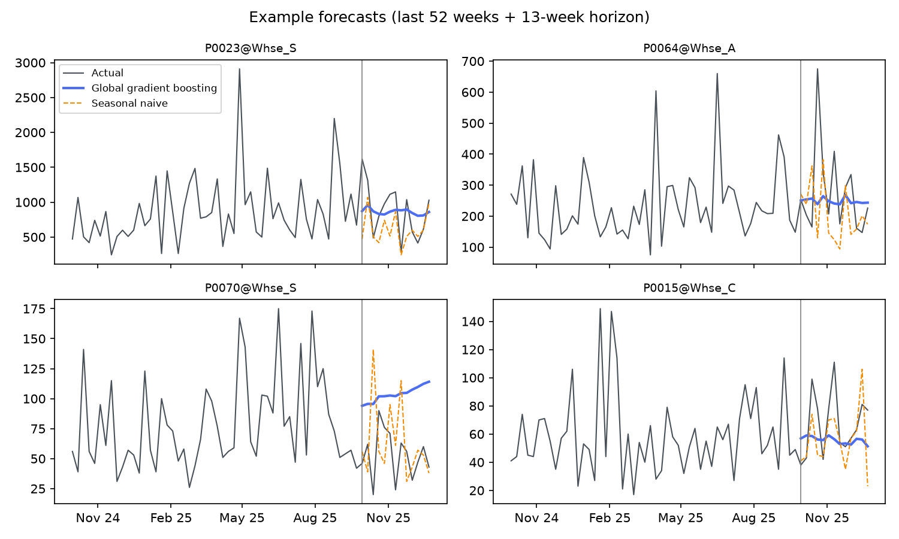

# Demand Forecasting & Inventory Backtest

_Generated by `make backtest`._ 200 SKU-warehouse series,
weekly data from Jan 2023 to Dec 2025.
Forecasts are made 13 weeks ahead from 29 Sep 2025 using only earlier data.

## Accuracy

| model                    | WAPE   | Bias   |   MASE | fill_rate   |   avg_inventory_units |
|:-------------------------|:-------|:-------|-------:|:------------|----------------------:|
| Global gradient boosting | 43.4%  | -10.1% |   0.88 | 98.2%       |                58,791 |
| Moving average (8w)      | 43.9%  | 1.8%   |   0.91 | 98.8%       |                68,055 |
| Holt-Winters             | 45.8%  | -3.7%  |   1    | 99.2%       |                67,830 |
| Seasonal naive           | 54.4%  | -21.7% |   1.11 | 97.6%       |                59,461 |

- **WAPE**: total absolute error as a share of total demand (lower is better)
- **Bias**: positive means over-forecasting
- **MASE**: error relative to a same-week-last-year forecast, median across series (below 1 beats it)

## From accuracy to inventory

Each model drives a weekly order-up-to policy with a 2-week lead time and safety stock sized
for a 95% service target from that model's own historical error.

**Global gradient boosting** reaches a 98.2% fill rate while holding
**14% less inventory** than an 8-week moving average,
the method most planning spreadsheets use (98.8% fill rate).

